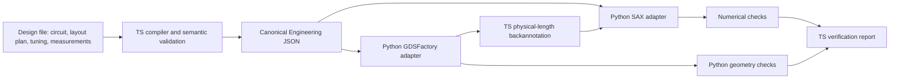

# ADR-001: TypeScript engineering core, Python scientific backends

Status: **Accepted**. This decision supersedes the initial Python-core prototype.

AgentPIC separates engineering logic from scientific computation. TypeScript owns the Engineering IR, design compiler, semantic verification, workflow runtime, API and MCP. Python owns scientific adapters: SAX circuit analysis, GDSFactory layout generation, numerical checks, and geometric DRC. FDTDX/FEM/EME are reserved for future adapters; no electromagnetic solver is required for this milestone.

## 1. Single source of truth

`core/src/contracts.ts` defines Component, Port, Connection, Circuit, PDK, EngineeringIR, requests, results, and verification reports using TypeScript and Zod. `npm run generate` exports JSON Schema into `schemas/`, then uses the locked datamodel-code-generator to generate `src/agentpic/ir.py`. Never edit the generated Python models. The generic Python base model only sets validation policy, not engineering definitions. CI regenerates both outputs and rejects drift.

The public contract is version 3.0 (see ADR-007); earlier run artifacts are not silently migrated. Units are explicit in field names. Supported model identifiers are owned by AgentPIC; backend objects never form part of the IR.

## 2. Backend independence

`core/src/backends.ts` defines the `ScientificBackend` interface. The default adapter invokes uv-managed Python workers using one JSON request/response per process. Workers validate generated Pydantic models and return data validated again against the source Zod contracts. All core orchestration calls this interface; tests can inject a failing or alternate adapter.

SAX dictionaries and GDSFactory objects stay in Python. The SAX adapter translates standard Circuit IR to its private netlist. The layout adapter normalizes GDSFactory's extracted connectivity into AgentPIC Circuit/Port/Connection records before returning it. No library-owned object is serialized into core contracts. Each layout operation runs in an isolated process, so GDSFactory's global PDK/cell caches cannot collide across requests.

## 3. Deterministic engineering verification

JSON Schema validates structure; it does not establish electrical/optical correctness. `core/src/compiler.ts` separately checks unique component/port names, endpoint references, port occupancy, domain/direction compatibility, connected topology, supported model parameters, PDK width constraints, and workflow dependency cycles/missing references. Invalid engineering data that passes the schema is still rejected.

TypeScript also compares extracted/intended connectivity, physical port alignment, centerline lengths and declared layout constraints, and aggregates verification status. Python independently checks the complex SAX result against dense network elimination of the submitted netlist, checks spectral sampling adequacy against that reference and reopens GDS for geometric checks. Numerical or DRC checks are never replaced with TS approximations or a successful process exit.

## 4. Agent-first interfaces

The HTTP API and MCP use the same Zod contracts, compiler and runtime. Both return machine-readable results. No GUI or language-model API is needed for execution; an external AI agent invokes deterministic tools. Static layout previews are derived from GDS and have no engineering authority.

## Executable paths

The circuit-only path simulates the lengths written in the design. When the design has a layout plan, the full path places cells, routes waveguides, measures the routed lengths and backannotates them before SAX.

## Execution and model boundaries

Node.js 22+ runs the core; uv owns Python 3.12–3.13 in `.venv`. `package-lock.json` and `uv.lock` pin environments. Runtime persists normalized specifications, compiled/resolved IR, task states, events, hashes and source/contract/environment provenance. A backend failure blocks dependent tasks and retains evidence. Execution is local and synchronous; automatic resume, distributed queues and crash recovery are not implemented.

`sin_demo_v1` is an illustrative process, not a foundry PDK. Its ideal couplers and assumed waveguide indices are mathematically checked but are not calibrated to the GDS polygons or a fabricated material stack. Reports explicitly record EM calibration, measurement validation and foundry signoff as `not_run`; `foundry_signoff` is constrained to false.

## ADR-002: Evidence-driven physics investigations

Accepted as a supporting EDA capability. The physics runtime is a generic experiment/evidence loop; capability policy plugins own model-specific semantics, physical principles, fixed criteria and experiment selection. Numerical algorithms and reference calculations execute behind a Python adapter. The first plugin uses SciPy for planar TE mode analysis, with independent dispersion and convergence evidence. The current roadmap keeps the complete EDA and MZI workflow as Stage 1–2 acceptance; standalone physics reasoning does not supersede that objective.

A registered capability is implemented, not universally verified. Per-revision benchmark evidence and per-run acceptance checks are required. Missing capabilities produce technical specifications and development dependencies for an external coding agent. LLM proposals are testable hypotheses and cannot change deterministic criteria or supply numerical proof.

## ADR-003: Logical hierarchy and explicit physical assembly

Accepted; the physical assembly plan below is superseded by ADR-007. Reusable module definitions and alias resolution belong to the TypeScript compiler. Flattened primitive IDs encode hierarchy paths without collisions; source-path records preserve traceability. Backends receive neutral primitive circuits rather than library-specific hierarchy objects.

Physical assembly is a separate explicit plan, bound to the submitted intent by semantic verification. The first implementation supports 2–4 MZI blocks connected in series. GDSFactory places their primitives and real interconnects, extracts connectivity and returns measured lengths. Nominal source definitions are preserved while resolved simulation lengths are backannotated. Independent numerical verification composes analytic transfer matrices rather than reusing the SAX network solver. This decision enables further supported design recipes without claiming arbitrary hierarchy placement, routing or optical calibration.

## ADR-004: Controlled optical state and mixed-domain ports

Accepted. A phase-shifter primitive has two optical and two electrical ports, a complete routed optical length and an explicitly commanded phase at the reference wavelength. The circuit backend projects the graph onto optical ports; it never treats exposed electrical terminals as optical S-parameters. Compiler and physical verification retain both domains and reject incompatible connections.

Optical control state and actuator geometry are distinct evidence: `controls.json` records the phase/active-length request and uncalibrated electrical mapping; layout data records actual metal footprints and terminals. GDSFactory supplies metal geometry, while independent KLayout readback checks it. Changing control state preserves polygons. A future calibrated electrothermal adapter must supply its own units, validity range and evidence before accepting voltage or heating-power requests. Direct phase specification does not stand in for that calibration.

## ADR-005: Target intent, bounded search and independently verified operating points

Accepted; candidate replay now uses generic network elimination (ADR-007). Target powers and selected phase-variable paths belong to the typed specification; applied operating points are separate IR state. TypeScript resolves variables, validates units/ports/bounds, schedules optimization after physical length backannotation and verifies state preservation. Original specification/hierarchy and the measured pre-tuning IR remain immutable artifacts.

Python reuses SciPy bounded least squares and a parameterized SAX evaluator. Every objective call, including finite-difference probes, consumes the explicit search budget. Deterministic starts avoid relying on a stationary initial phase. The numerical adapter reports the best evaluated candidate and honest search termination, not an engineering verdict.

Acceptance independently reads final S-parameters, checks targets and trace/bounds/budget consistency, and replays every candidate through the existing analytic transfer composition without importing SAX. Search status cannot override these checks. Local search does not establish global optimality, feasibility, calibrated electrothermal control or fabrication readiness. An unmet target retains the best operating point and complete failed-report evidence.

## ADR-006: Feedback topology with independent spectral adequacy checks

Accepted; the ring recipe and its closed-form summation are superseded by ADR-007. Feedback cycles are ordinary neutral Circuit connections, not recursively defined hierarchy. SAX remains the network solver. The first feedback recipe is a four-port MMI-coupled add/drop ring, assembled from existing ideal couplers and return waveguides. GDSFactory places the actual primitives and routes; measured paths feed the same simulation and optimization workflow.

Independent numerical verification uses closed-form geometric-series summation for the ring and retains full complex reciprocity/passivity checks. A separate spectral module predicts resonant phase orders and evaluates actual peak positions, adjacent spacings and half-maximum widths from the exported spectrum with SciPy/NumPy. Correct isolated samples do not establish a resolved spectrum: minimum linewidth sampling and complete-resonance coverage are acceptance requirements. Ideal-model Q and wavelengths remain explicitly uncalibrated; geometric coupling calibration and finite MMI phase/delay require separate models and evidence.

## ADR-007: Designs are data; engines never name a device

Accepted. Supersedes the device recipes of ADR-003, ADR-005 and ADR-006.

**Rule: adding a device must not change compiler, simulation, verification or layout code.** `core/tests/architecture.test.ts` enforces it by scanning `core/src` and `src/agentpic` for device families, instance names and port names, and by forbidding imports from `designs/`.

A design file (`DesignSpec` 3.0) carries everything device-specific as data:

- `circuit`: a flat netlist or a module hierarchy. Hierarchical designs are flattened by the existing compiler; layout and tuning refer to instances by source path such as `second/top_arm`.
- `port_order`: the explicit S-matrix order of every external optical port.
- `layout` (optional): `placements` (absolute, or a port anchored to another instance's port with an offset), `routes` (Manhattan steps: `dx_um`, `dy_um`, `x_um`, `y_um`, `x_from_end_um`, `y_from_end_um`; the engine adds at most one final corner and smooths with the PDK bend radius) and `constraints` (`length`, `length_difference`). Couplers are placed; waveguides and phase shifters are placed as straights or routed between two placed ports. Actuators sit on the longest straight section of their waveguide.
- `tuning` and `measurements` (optional): target powers over phase variables, and spectral measurements such as complete resonances between two ports.

Verification is generic. The independent reference is dense network elimination of the submitted netlist (`src/agentpic/circuit_reference.py`); it checks the network solver, not the physics of the ideal models. A sampling check compares midpoint interpolation of exported powers with that reference, so an undersampled spectrum fails even when every sample is right. Device closed forms (MZI power law, cascade identity, ring drop formula, free spectral range) are golden references in the tests, never in the engine.

Device knowledge lives in `designs/templates.ts`, which writes the checked-in `designs/*.json`; CI regenerates them and rejects drift. This mirrors digital EDA practice, where a CPU is an input to the tools rather than a code path inside them.

## ADR-008: The PDK is data with sources

Accepted. Process facts live in `pdks/<name>.json`, validated by the `PDK` contract and copied into every Engineering IR; the design names its PDK with `pdk`. The engine hard-codes none of them: port lists and parameter ranges in semantic checks, cross-sections, layers, rules and cells in layout, and mode parameters in SAX and the independent reference are all read from the PDK. The design ID hashes the PDK content, and provenance records its hash.

Every material, mode model and component carries a source (`assumption`, `literature`, `characterization`, `measurement`, `foundry`) with a reference and a calibration flag. Verification reports list every uncalibrated source as a limitation, so an assumed index can never look like a measured one. Backends declare which model versions they implement and reject others; the layout backend rejects a cell whose ports disagree with the PDK declaration.

Open PDKs (cspdk 2.1.0, ubcpdk 1.3.4) were assessed and ship only placeholder compact models (see `docs/research.md`), so they are not used as model sources. ADR-009 replaces `sin_demo_v1`'s assumed waveguide indices with characterization evidence.

## ADR-009: Physics evidence from FDTDX, validated before it is trusted

Accepted. Circuits are solved only by SAX; electromagnetic fields only by FDTDX (MIT, JAX FDTD). FDTDX is an optional `em` dependency group. It installs tidy3d as a dependency, but AgentPIC code never imports tidy3d and never uses FDTDX's tidy3d-backed mode sources, mode detectors or `compute_mode`; `core/tests/architecture.test.ts` enforces this. Only FDTD time stepping, a uniform plane source and a phasor detector are used.

`src/agentpic/characterize.py` characterizes a PDK cross-section offline. A continuous wave is launched into a straight guide whose material indices come from the PDK's Sellmeier data at each wavelength; the effective index is the slope of the phase of cross-section field projections along the guide. The ladder of evidence is:

1. **Method validation**: the same pipeline on a symmetric slab of the same materials must reproduce the existing analytic slab dispersion solution (`planar_modes.py`) after extrapolation.
2. **Convergence**: three grids per wavelength, Richardson extrapolation at the observed order; the order, the extrapolation correction, the phase-fit residual and the projection amplitude spread must lie within predeclared criteria.
3. **Group index**: central difference of extrapolated indices across three wavelengths, so material dispersion is included.

Accepted results update the PDK mode model with source `characterization` (still `calibrated: false`: a simulation, not a measurement) and an evidence file. Every design run verifies that evidence (`mode_characterization`) and reports which used models still lack electromagnetic evidence (`electromagnetic_characterization`); the MMI coupler, a fixed cell, needs device-level characterization of its own and remains `not_run`.

## ADR-010: The capability audit is code with test evidence

Accepted. `core/src/capabilities.ts` lists every capability with a domain, a status (`implemented`, `partial` or `missing`), the tests that prove it and its limitation. `core/tests/capabilities.test.ts` fails if an implemented or partial capability names no test or a test that does not exist, or if a missing capability claims evidence. The same list is served by `GET /v1/capabilities`, MCP `get_capabilities` and `agentpic capabilities [--missing]`, and generates the README table, which CI checks for drift. An agent choosing the next task reads the missing list rather than prose.
