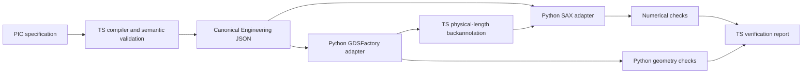

# ADR-001: TypeScript engineering core, Python scientific backends

Status: **Accepted**. This decision supersedes the initial Python-core prototype.

AgentPIC separates engineering logic from scientific computation. TypeScript owns the Engineering IR, design compiler, semantic verification, workflow runtime, API and MCP. Python owns scientific adapters: SAX circuit analysis, GDSFactory layout generation, numerical checks, and geometric DRC. FDTDX/FEM/EME are reserved for future adapters; no electromagnetic solver is required for this milestone.

## 1. Single source of truth

`core/src/contracts.ts` defines Component, Port, Connection, Circuit, PDK, EngineeringIR, requests, results, and verification reports using TypeScript and Zod. `npm run generate` exports JSON Schema into `schemas/`, then uses the locked datamodel-code-generator to generate `src/agentpic/ir.py`. Never edit the generated Python models. The generic Python base model only sets validation policy, not engineering definitions. CI regenerates both outputs and rejects drift.

The public contract is version 2.0; the Python-core prototype's 1.0 run artifacts are not silently migrated. Units are explicit in field names. Supported model identifiers are owned by AgentPIC; backend objects never form part of the IR.

## 2. Backend independence

`core/src/backends.ts` defines the `ScientificBackend` interface. The default adapter invokes uv-managed Python workers using one JSON request/response per process. Workers validate generated Pydantic models and return data validated again against the source Zod contracts. All core orchestration calls this interface; tests can inject a failing or alternate adapter.

SAX dictionaries and GDSFactory objects stay in Python. The SAX adapter translates standard Circuit IR to its private netlist. The layout adapter normalizes GDSFactory's extracted connectivity into AgentPIC Circuit/Port/Connection records before returning it. No library-owned object is serialized into core contracts. Each layout operation runs in an isolated process, so GDSFactory's global PDK/cell caches cannot collide across requests.

## 3. Deterministic engineering verification

JSON Schema validates structure; it does not establish electrical/optical correctness. `core/src/compiler.ts` separately checks unique component/port names, endpoint references, port occupancy, domain/direction compatibility, connected topology, supported model parameters, PDK width constraints, and workflow dependency cycles/missing references. Invalid engineering data that passes the schema is still rejected.

TypeScript also compares extracted/intended connectivity, physical port alignment, centerline lengths and requested imbalance, and aggregates verification status. Python independently checks the complex SAX result against analytic interference equations and reopens GDS for geometric checks. Numerical or DRC checks are never replaced with TS approximations or a successful process exit.

## 4. Agent-first interfaces

The HTTP API and MCP use the same Zod contracts, compiler and runtime. Both return machine-readable results. No GUI or language-model API is needed for execution; an external AI agent invokes deterministic tools. Static layout previews are derived from GDS and have no engineering authority.

## Executable paths

The circuit-only path uses a nominal 800 µm base arm plus the requested imbalance; it is the first architecture acceptance test. The full design path measures actual routed lengths and backannotates them before SAX. This preserves the previous GDS milestone under the new architecture without maintaining two compilers.

## Execution and model boundaries

Node.js 22+ runs the core; uv owns Python 3.12–3.13 in `.venv`. `package-lock.json` and `uv.lock` pin environments. Runtime persists normalized specifications, compiled/resolved IR, task states, events, hashes and source/contract/environment provenance. A backend failure blocks dependent tasks and retains evidence. Execution is local and synchronous; automatic resume, distributed queues and crash recovery are not implemented.

`sin_demo_v1` is an illustrative process, not a foundry PDK. Its ideal couplers and assumed waveguide indices are mathematically checked but are not calibrated to the GDS polygons or a fabricated material stack. Reports explicitly record EM calibration, measurement validation and foundry signoff as `not_run`; `foundry_signoff` is constrained to false.

## ADR-002: Evidence-driven physics investigations

Accepted as a supporting EDA capability. The physics runtime is a generic experiment/evidence loop; capability policy plugins own model-specific semantics, physical principles, fixed criteria and experiment selection. Numerical algorithms and reference calculations execute behind a Python adapter. The first plugin uses SciPy for planar TE mode analysis, with independent dispersion and convergence evidence. The current roadmap keeps the complete EDA and MZI workflow as Stage 1–2 acceptance; standalone physics reasoning does not supersede that objective.

A registered capability is implemented, not universally verified. Per-revision benchmark evidence and per-run acceptance checks are required. Missing capabilities produce technical specifications and development dependencies for an external coding agent. LLM proposals are testable hypotheses and cannot change deterministic criteria or supply numerical proof.

## ADR-003: Logical hierarchy and explicit physical assembly

Accepted. Reusable module definitions and alias resolution belong to the TypeScript compiler. Flattened primitive IDs encode hierarchy paths without collisions; source-path records preserve traceability. Backends receive neutral primitive circuits rather than library-specific hierarchy objects.

Physical assembly is a separate explicit plan, bound to the submitted intent by semantic verification. The first implementation supports 2–4 MZI blocks connected in series. GDSFactory places their primitives and real interconnects, extracts connectivity and returns measured lengths. Nominal source definitions are preserved while resolved simulation lengths are backannotated. Independent numerical verification composes analytic transfer matrices rather than reusing the SAX network solver. This decision enables further supported design recipes without claiming arbitrary hierarchy placement, routing or optical calibration.
