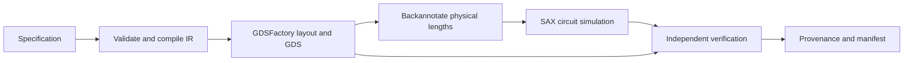

# Interface contract, version 1.0

All interfaces call the same compiler/runtime. Public Pydantic models reject unknown fields and non-finite numbers; JSON Schema is generated from those models. `schemas/` contains the specification, IR, result, verification report and OpenAPI contracts. Regenerate them with `uv run python scripts/export_schemas.py`; CI checks for drift. MCP's `tools/list` advertises the current input and structured-output contracts.

## Specification

| Field | Default | Constraint / unit |
|---|---|---|
| `device` | `mzi` | Only `mzi` |
| `platform` | `sin` | Only `sin`; illustrative process `sin_demo_v1` |
| `wavelength_nm` | 1550 | 1500–1600 nm |
| `outputs` | All four | Nonempty, unique subset of `netlist`, `simulation`, `gds`, `verification` |
| `delta_length_um` | 10 | −200 to +200 µm; top arm minus bottom arm |
| `sweep_span_nm` | 40 | Greater than zero, at most 100 nm |
| `sweep_points` | 201 | Odd integer, 3–2001 |

The entire sweep must be in 1450–1650 nm. An odd number of points includes the requested center wavelength. These are software support bounds, not a claim of calibrated material-model validity. The API accepts a specification object directly; MCP tools accept it under the `specification` argument.

The normalized input is SHA-256 hashed to a 16-character design ID. IDs also depend on requested outputs and sampling settings. The source hash, model version, dependency versions and lock hash distinguish software/environment revisions; a design ID alone is not a provenance guarantee.

## Compilation and execution

The compiler chooses the supported MZI template, emits named components, typed endpoints, technology/model assumptions, and a dependency DAG. Compilation does not generate GDS or fabricate values for unresolved waveguide lengths.

The runtime executes the DAG locally and synchronously, writing state after each transition. Task states are `pending`, `running`, `completed`, `failed`, and `blocked`. A backend exception fails the run and blocks dependent tasks, retaining partial artifacts and the error. A completed verification task can produce failing checks; the run then reports `failed`. Interrupted processes may leave partial runs; automatic crash recovery, resume, cancellation, timeout enforcement and distributed scheduling are future work.

GDSFactory uses global PDK/cell caches. A process-local lock serializes runtime engine access. Backend protocols support dependency injection, but the current compiler and independent analytic verifier intentionally target the supported MZI topology. Adding a topology requires extending both compilation and its verification policy.

## Results and evidence

`RunResult` contains the version, run/design IDs, status, verification status, server-local artifact directory, artifact inventory and optional execution error. A transport success is not an engineering pass. `VerificationReport` contains a status, individual check IDs, `pass`/`fail`/`not_run`, evidence, limitations and `foundry_signoff: false`.

HTTP clients download artifacts using the artifact endpoint, not the server-local path. MCP uses the artifact resource template. `manifest.json` and `run.json` are also readable artifacts but are not included in their own checksum inventories. The saved run result is the local integrity reference, not a signed attestation. Reverification returns a new report without overwriting the original evidence or its recorded hashes.

The EM request/result contracts are placeholders for future adapters. They are not yet a complete meshing, material dispersion or solver configuration IR, and no EM execution tool is advertised.
